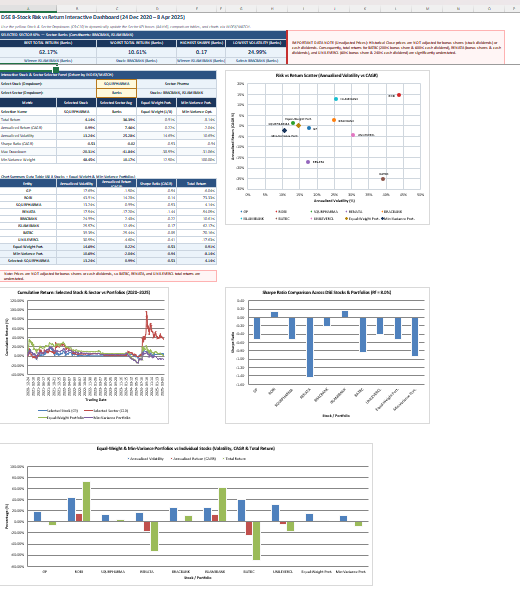
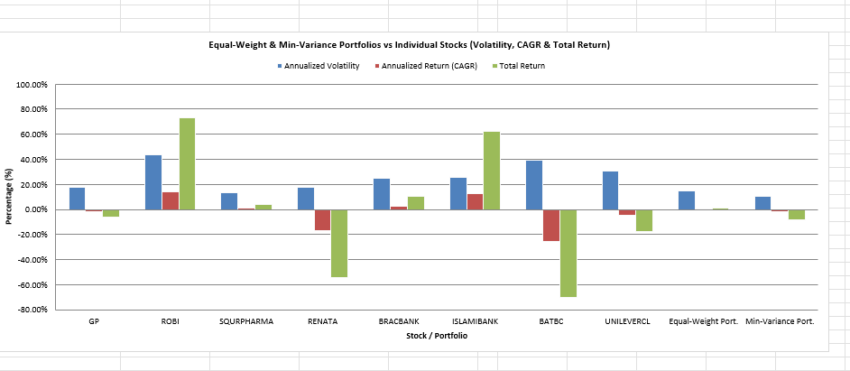
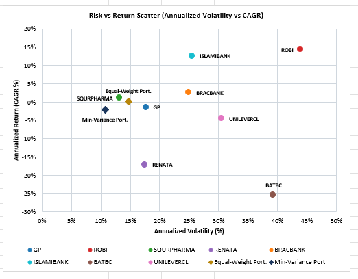
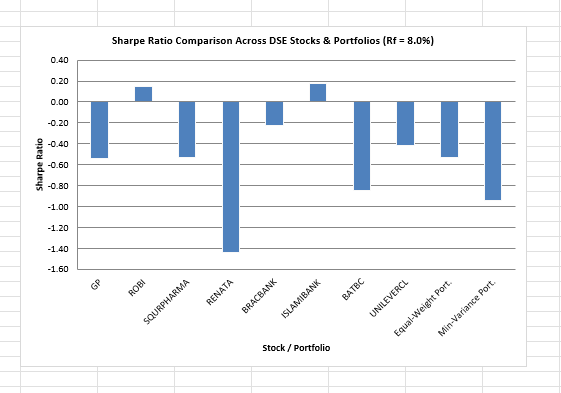
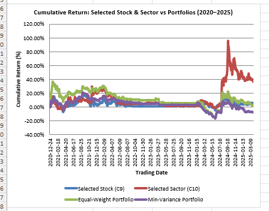

# DSE Stock Risk vs Return Analysis

Which Dhaka Stock Exchange stocks paid you fairly for the risk, and could mixing them cut that risk? I looked at 8 DSE stocks from 24 Dec 2020 to 8 Apr 2025 (1,031 trading days), all in Excel.

**Stocks:** GP and ROBI (telecom), SQURPHARMA and RENATA (pharma), BRACBANK and ISLAMIBANK (banks), BATBC and UNILEVERCL (consumer).

## Data
Mendeley Data, "Dhaka Stock Exchange Historical Data (1999-2025)", Sunny, Nafis and Khan (2025), CC BY 4.0, DOI 10.17632/5mww8rb9td.1
https://data.mendeley.com/datasets/5mww8rb9td

The raw file needed cleaning. 184 trading days appeared twice, and many dates before July 2022 had day and month swapped, which would have created 135 false crashes of more than 10%. I removed the duplicates and fixed the dates. Days with no trade use the previous close. The analysis starts on 24 Dec 2020 because that is ROBI's first trading day.

## What the workbook does
- Daily returns, annual return (CAGR), volatility, Sharpe ratio and max drawdown for each stock
- An 8 x 8 correlation matrix with a heatmap
- Sector averages
- An equal-weight portfolio against a minimum-variance portfolio
- A dashboard with stock and sector dropdowns
- A sheet that flags every one-day drop of 10% or more and checks it against dividend news

Everything is a live Excel formula, so you can click any cell and see how it was calculated. The risk-free rate (8%) is a placeholder in the Assumptions sheet. Change it and every Sharpe ratio updates.

## Key metrics

## Risk vs return

## Sharpe ratio

## Growth of 100 BDT

## What I found
**Only two stocks beat the 8% risk-free rate.** ISLAMIBANK returned 12.45% a year (Sharpe 0.17) and ROBI 14.28% (Sharpe 0.14). ROBI's gain starts from its 15 BDT listing-day price, and its worst drawdown was -70.76%, so I would not call it a clear winner.

**SQURPHARMA was the calmest.** Volatility 13.24%, worst drawdown -20.31%, and a small total gain of 4.14%.

**Banks did best on average by sector.** Total return +36.39%, ahead of telecom at +33.65%. Pharma had the lowest volatility (15.39%) but averaged -24.95% because of RENATA.

**Diversification cut risk but cost return.** The average correlation between the stocks is only 0.203. The equal-weight portfolio has 14.69% volatility, and 100 BDT became 100.91. The minimum-variance portfolio cut volatility to 10.69%, but 100 BDT became 91.86 and its Sharpe ratio (-0.94) is worse than equal weight (-0.53). It minimizes risk and ignores return.

**Three one-day drops of 10% or more.** BATBC (-64.17%, 4 Mar 2021) and UNILEVERCL (-37.46%, 4 Apr 2023) line up with stock dividends. ROBI (-10.00%, 19 Mar 2024) is only partly explained: a 1 BDT dividend cannot explain a 3 BDT fall, so it was probably the daily price limit. I flagged the drops and did not adjust prices.

## Limitations
1. Prices are not adjusted for bonus shares or cash dividends. BATBC, RENATA and UNILEVERCL returns are understated, and much of BATBC's -70% comes from its 2021 stock dividend, not a real loss of that size.
2. Floor prices (Jul 2022 to Jan 2024) froze many stocks for months, which understates volatility.
3. ROBI has a shorter history and a listing-day spike that inflates its volatility and drawdown.
4. Filling no-trade days with the previous close slightly lowers measured volatility.
5. Eight stocks over about four years is a small sample.

This is a learning project, not investment advice.

## Files
- `DSE_Risk_Return_Project.xlsx`: the full workbook
- `Summary.pdf`: one-page summary
- `dashboard.png`, `metrics.png`, `scatter.png`, `sharpe.png`, `cumulative.png`: screenshots

Built by Muhammad Sadat Samin, BBA (Finance), Independent University, Bangladesh.
